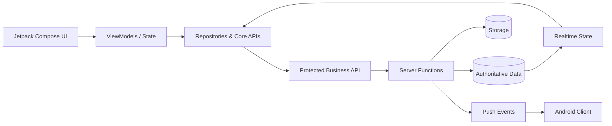

# Call Me Taxi — Engineering Showcase

> Public engineering case study for a production-oriented native Android taxi platform covering customer booking, driver operations, realtime state, trip settlement, finance workflows and staff tooling.

## Why this repository exists

This is a **public portfolio showcase**, not the production source repository.

The full application source remains private because it contains proprietary implementation details. This public repository focuses on architecture, engineering decisions, system boundaries and the kinds of production problems the project is designed to solve.

No production credentials, customer data, private infrastructure details, signing material, database dumps or operational logs are published here.

## Project at a glance

| Area | Engineering scope |
|---|---|
| Client | Native Android, Kotlin, Jetpack Compose, Material 3 |
| State | ViewModels, coroutines, Flow/StateFlow |
| Backend | Appwrite Database, Functions, Realtime and Storage |
| Notifications | Firebase Cloud Messaging |
| Location | Google Maps and Google Location Services |
| Roles | Customer, driver and operational staff workflows |
| Business domains | Booking, dispatch, trip lifecycle, finance, chat, reporting |
| Release posture | Externalized credentials, security checks and automated quality gates |

This showcase reflects the engineering direction of the private **1.7.x** source line.

## System architecture

The mobile client expresses user intent, but sensitive state transitions are validated by the backend before authoritative data changes.

## Engineering highlights

### Server-authoritative business operations
Order ownership, trip lifecycle changes, staff actions and transaction-sensitive finance operations are validated on the backend instead of trusting locally cached UI state.

### Session isolation
Login/logout and background work can race. The architecture uses session-generation fencing so a late response from an older session cannot silently become authoritative after a new login.

### Idempotent transaction-sensitive flows
Settlement and finance operations are designed around stable operation identity and authoritative records so retried requests do not create duplicate effects.

### Realtime and notification separation
Realtime synchronization and push notifications serve different purposes. Notification delivery is not treated as proof that a business operation succeeded.

### Security-oriented release configuration
Production credentials and signing material are kept outside the source tree. Repository security checks protect against accidentally publishing sensitive local artifacts.

## Product capabilities represented

- Customer account, booking and trip-history workflows
- Driver availability, dispatch, accept/start/complete lifecycle
- Realtime order and location state
- Meter and fixed-fare workflows
- Wallet, top-up, withdrawal, redeem and commission flows
- Server-authoritative trip settlement
- Private/support chat and operational announcements
- Admin and monitoring workflows
- Reports and operational analytics
- App update and release controls

## Distributed-system concerns

- stale sessions
- duplicate requests and retries
- realtime lag
- notification delivery differences
- competing order claims
- lifecycle race conditions
- stale local UI state
- network interruption during multi-step operations

## Repository guide

- [`docs/ARCHITECTURE.md`](docs/ARCHITECTURE.md) — deeper system boundaries and request flow
- [`docs/ENGINEERING_CASE_STUDY.md`](docs/ENGINEERING_CASE_STUDY.md) — design problems and engineering responses
- [`SECURITY.md`](SECURITY.md) — what is intentionally excluded from this public showcase
- [`LICENSE.md`](LICENSE.md) — portfolio-use terms

## Source access

The production source repository is private. Qualified employers or technical reviewers can request temporary read access for a deeper code review.

## Ownership

This showcase describes proprietary engineering work. Publishing this case study does not open-source the underlying application.
