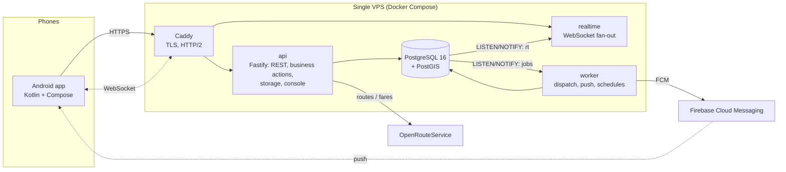

# Call Me Taxi: Ride-Hailing Platform Engineering Case Study

> A ride-hailing platform in production in Yangon: a native Android app for customers, drivers and operations staff, with **callme-core**, a self-hosted backend built for it.
> The backend handles realtime dispatch to about 1,000 drivers, live trip tracking and wallet settlement, and runs on a single 4 vCPU / 8 GB server.

This repository is the **public case study** of the project: architecture, design decisions, security model and the production problems that were diagnosed and fixed. The application and backend source are private. Qualified reviewers can ask for a guided code walkthrough.

---

## Results in numbers

| | Before | After |
|---|---|---|
| Time until the **last** of ~1,090 drivers sees a new order | 3.5 – 4.3 s | **1.0 – 1.2 s** (single bulk write instead of 1,090 inserts) |
| Orders lost right after a backend deploy (live drill) | 2 of 2 orders reached nobody | **0**: 3 of 3 cold-start and warm drills passed |
| Idle job-queue queries per minute | ~2,900 | **183** (NOTIFY-driven wake-up + one safety poll) |
| Chat sync calls per minute per active phone | 27 | **7** (delta sync on foreground) |
| Phones with a wrong clock (seen: **77 s** ahead) | orders hidden, early accept, GPS refused | handled: every business time is stamped by the server |
| Hosting | managed Backend-as-a-Service with per-request billing | **one 4 vCPU / 8 GB VPS**, load-tested at the agreed peak of **200 concurrently active drivers** with a 200 ms p95 budget |

---

## What the platform does

- **Customers** book with a pickup only or pickup + destination. Pickup + destination gets a fixed, road-route-based price. Customers follow the driver live on a map and chat with the driver; demands the driver adds (extra cargo, airport, ...) show up live in the price.
- **Drivers** hear new orders (voice notes included) with a fair accept lock, run the trip meter, settle trips into a wallet and see their earnings.
- **Operations staff** (Super Admin / Admin / Monitor) review and release customer orders, run a database console, manage users, wallets, pricing, time-of-day boosts and announcements.

---

## Architecture

- **api**: an HTTP API with document-style endpoints (list/query/create/update), file storage and a single *business action* endpoint. Every action validates the session, role and order state before it writes.
- **realtime**: WebSocket server. Every committed write is published once through Postgres `NOTIFY`, then filtered per socket by that user's read rules. Coalescing keeps GPS bursts bounded per driver.
- **worker**: a durable job queue in Postgres (`FOR UPDATE SKIP LOCKED`) that wakes on `NOTIFY`. It runs dispatch waves, push delivery and scheduled maintenance.
- **migrate**: versioned SQL migrations, applied on every deploy.

More detail: [docs/ARCHITECTURE.md](docs/ARCHITECTURE.md).

---

## Engineering highlights

**Dispatch that is fair and provably fast** ([docs/DISPATCH.md](docs/DISPATCH.md))
- VIP and free drivers hear an order first and drivers already on a trip 5 s later.
- Accept stays locked for *voice note + 3 s* (VIP: 0 s). The lock is enforced on the server, so an old app cannot bypass it.
- A winner's identity stays hidden until every other driver's lock has ended.
- Distance orders expand 1 → 2 → 3 → 4 km, then go citywide.
- Customer orders go to **one driver at a time, nearest first**, skipping empty rings instantly.

**Correct under concurrency and bad networks**
- Accept, cancel and settlement are transactional, with retries on serialization conflicts.
- Stable operation keys make retried requests idempotent.
- The realtime socket is re-established with the new session token on login, so a socket opened a moment too early cannot stay anonymous.

**Time you can trust**
- The server stamps order, alert and GPS times.
- Phones send *how old* a GPS fix is, measured on their monotonic clock, instead of a wall-clock time.
- The app learns the server-clock offset from every response.

**Observability built in**
- The worker logs one line per order event: queued delay, run time, offers created, pushes sent and failed.
- Push failures are grouped by FCM error code.
- The driver's live-position feed logs once a minute whether each fix was accepted, or why it was refused.

**Operations**
- Daily off-site backups (database dump + uploaded files) with a size check after upload and 30-day retention.
- A 5-minute health monitor alerts to Telegram on downtime, restarts, disk, memory, backup age and p95 latency.
- One-command upgrades keep the previous release on disk for rollback.

**Security by design** ([docs/SECURITY_DESIGN.md](docs/SECURITY_DESIGN.md))
- Hashed session tokens and device binding.
- Per-collection read/write policies on every endpoint *and* on the realtime stream.
- Argon2-protected admin console with an audit log and a read-only SQL role.
- Secrets live only on the server (never in the app, in git or in chat).
- Firewall and fail2ban are configured on the host.

---

## Selected production incidents

Each one is written up with symptom → evidence → root cause → fix → verification in [docs/ENGINEERING_CASE_STUDY.md](docs/ENGINEERING_CASE_STUDY.md).

1. **"Some orders don't ring."** A 60-second recipient cache, combined with a token clean-up, wiped the *new* push token of drivers who had just signed in again.
2. **Orders reached nobody after a deploy.** The cold-start path was reproduced with a live drill against production, using synthetic drivers with real users' push tokens set aside.
3. **The last drivers heard orders 4 s late.** Per-driver inserts were replaced with one bulk write: 1.0 s end to end.
4. **The customer saw no car.** A driver phone clock 77 s ahead made every GPS fix look "from the future"; the server refused them all.
5. **Distance dispatch silently stopped.** A read inside an event transaction saw its own staged write.
6. **The worker ran out of heap every ~3.5 h.** Idle poll waiters were never released.

---

## Technology

| Layer | Choices |
|---|---|
| Android | Kotlin, Jetpack Compose, Material 3, coroutines/Flow, Google Maps SDK, Fused Location, FCM, R8 |
| Backend | Node.js 22, Fastify, `pg`, firebase-admin, argon2, node:test |
| Data | PostgreSQL 16 + PostGIS, `pg_stat_statements`, UNLOGGED table for high-rate driver positions |
| Realtime | WebSocket, Postgres `LISTEN/NOTIFY`, per-socket authorization, write coalescing |
| Infra | Docker Compose, Caddy (automatic TLS), ufw, fail2ban, systemd timers |
| External | Firebase Cloud Messaging, OpenRouteService (road routes and fares), Google Maps |

## Repository guide

| Document | What it covers |
|---|---|
| [ARCHITECTURE.md](docs/ARCHITECTURE.md) | Components, data model, request and event flow, deployment |
| [DISPATCH.md](docs/DISPATCH.md) | Dispatch rules, accept lock, sequential customer dispatch, fares |
| [ENGINEERING_CASE_STUDY.md](docs/ENGINEERING_CASE_STUDY.md) | Six production incidents, investigated and fixed |
| [MIGRATION.md](docs/MIGRATION.md) | Moving a live app from a managed BaaS to its own backend without changing user experience |
| [SECURITY_DESIGN.md](docs/SECURITY_DESIGN.md) | Threat model, authentication, authorization, secrets, host hardening |
| [OPERATIONS.md](docs/OPERATIONS.md) | Deploy, rollback, backups, monitoring, testing strategy |
| [SECURITY.md](SECURITY.md) | What this public repository deliberately does not contain |

Sister product on the same platform: [Mingalarpar Taxi](https://github.com/ywtzcloud/mingalarpar-taxi-showcase).

---

© 2026. Portfolio material, see [LICENSE.md](LICENSE.md). The production application and backend are proprietary.
