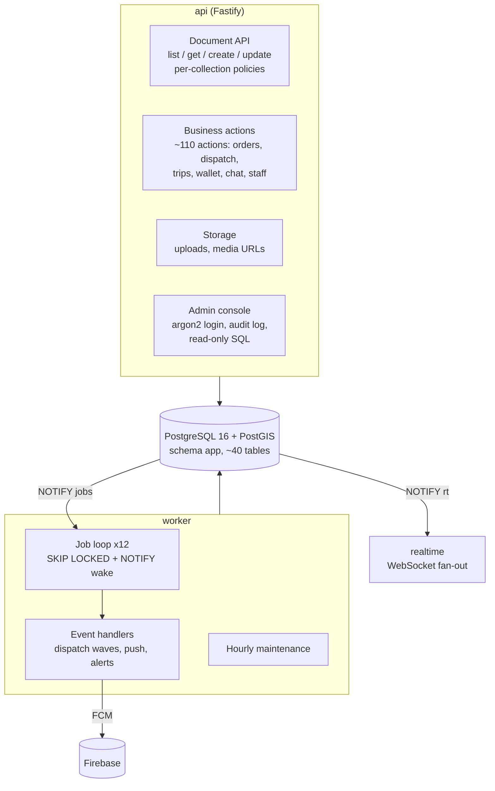
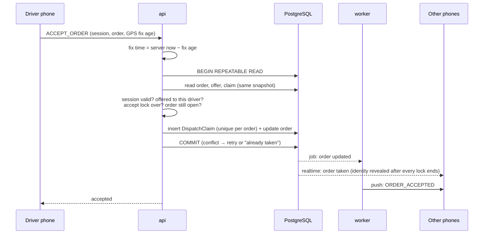
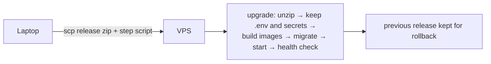

# Architecture

## Goals and constraints

| Goal | Consequence for the design |
|---|---|
| **No visible change for ~1,000 existing users** when the backend moved | The new backend speaks the API the shipped Android app already uses (document queries, realtime channels, storage URLs, function executions). Existing clients keep working while new app versions roll out. |
| **Fast on modest hardware** | One VPS, 4 vCPU / 8 GB. Every hot path is measured (`pg_stat_statements`, per-action p50/p95) and tuned against a 200 ms p95 budget at 200 concurrently active drivers. |
| **Business rules enforced by the server** | Phones express intent. The server validates session, role, order state and money before any write. |
| **Operable by one person** | One `docker compose` project, one-command upgrades with the previous release kept for rollback, automated backups and alerting. |

## Components

### api
- **Document API**: query-style reads with filters, ordering, cursor pagination and field selection, plus create and update. Each collection has a policy object (`read`, `create`, `update`) that returns allow/deny plus a row filter and field strip. The same policy is reused by the realtime stream, so a document a user cannot read over HTTP never reaches their socket either.
- **Business actions**: one endpoint, `{action, ...payload, sessionToken}`, runs inside a single `REPEATABLE READ` transaction with automatic retry on serialization conflicts. Examples:
  - `CREATE_ORDER`, `ACCEPT_ORDER`, `CANCEL_ORDER`, `SET_ORDER_LOCK`;
  - `CUSTOMER_FARE_QUOTE`, `CUSTOMER_DRIVER_TRACKING`, `CUSTOMER_DEMAND_UPDATE`;
  - wallet top-ups and withdrawals;
  - staff release and route edits.
- **Request normalisation** happens before business code runs. Phone-supplied times are moved onto the server clock, and GPS fixes are dated from the fix *age* the phone measured.
- **Admin console**: a web UI for staff to browse and edit data.
  - Login is argon2-hashed. Edits are validated against the schema and use per-field optimistic concurrency, so an edit is refused only if *that field* changed.
  - Every change goes to an audit table.
  - SQL runs as a dedicated read-only role, one statement at a time.

### realtime
- Clients subscribe to channels, e.g. all orders or one chat.
- Every committed write is published once through Postgres `NOTIFY`. Large documents are sent by reference and fetched by the listener.
- Per socket, the server applies the user's read policy. It serialises a message once when it is identical for many sockets.
- Driver-position updates are coalesced per driver, so a slow phone receives the *latest* position instead of a growing backlog. A hard buffer limit closes sockets that stop reading.
- The session is bound at the handshake. The app reconnects after login so the socket always carries the current identity.

### worker
- Writes that matter for side effects enqueue a row in `jobs` within the same commit and `NOTIFY jobs`.
- Twelve loops sleep until notified. One safety poll per second covers a missed notification. This replaced a design where every idle loop polled four times a second: 2,900 → 183 queue queries per minute.
- Jobs are claimed with `DELETE ... FOR UPDATE SKIP LOCKED` (at-most-once) and logged with queue delay and run time.
- Startup warms the push client (FCM credentials) so the first order after a deploy is not delayed.

### Data model
- PostgreSQL schema `app`: one table per business collection, about 40 in total. Examples are `RideOrder`, `TripRecord`, `DispatchOffer`, `DispatchClaim`, `UserAccount`, `WalletHistory`, `ChatMessage` and `ActiveDriverLocation`.
- Columns are typed; system fields are `$id`, `$createdAt` and `$updatedAt`.
- A metadata table keeps each collection's attribute and index definitions. Validation (types, ranges, required fields) is enforced the same way for API and console writes.
- `ActiveDriverLocation` is **UNLOGGED**: positions are rewritten every few seconds and are worthless after a crash, so they skip the WAL and fsync cost.
- Migrations are numbered SQL files, applied on each deploy by the `migrate` container.

## Request flow: accepting an order

Two drivers accepting at once is handled by the unique claim row and the transaction: exactly one commit wins, and the other gets a clean "already taken".

## Deployment

- One Docker Compose project (`db`, `api`, `realtime`, `worker`, `migrate`), with Caddy in front for automatic TLS.
- Secrets live in a root-only env file and a mounted secrets directory on the server. They are never in the image, in git or in the app.
- Postgres is tuned for 4 vCPU / 8 GB:
  - `shared_buffers` 2 GB, `effective_cache_size` 5 GB, `work_mem` 16 MB;
  - JIT off, because it is pure CPU cost for an OLTP workload;
  - `pg_stat_statements` on;
  - lock waits logged above 200 ms.

## Android client

- Kotlin, Jetpack Compose, Material 3, ViewModels with `StateFlow`, repositories per domain.
- A realtime hub multiplexes logical listeners onto one physical subscription per channel and closes it when the app is in the background.
- **Session fencing**: every session has an epoch. A response that arrives after logout or re-login is dropped instead of being applied to the new session.
- **Location**:
  - fused location, with a 1 s on-screen position for the driver's own car;
  - lower-rate presence updates to the server;
  - smooth marker animation between fixes, at about 30 fps.
- **Build**:
  - R8 release builds with verbose logs stripped;
  - a separate "Testing" build type, with its own package, icon and Firebase project, installs next to the store app;
  - unit tests run against that build type.
