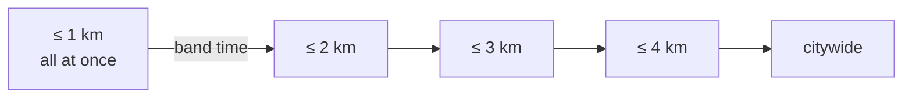
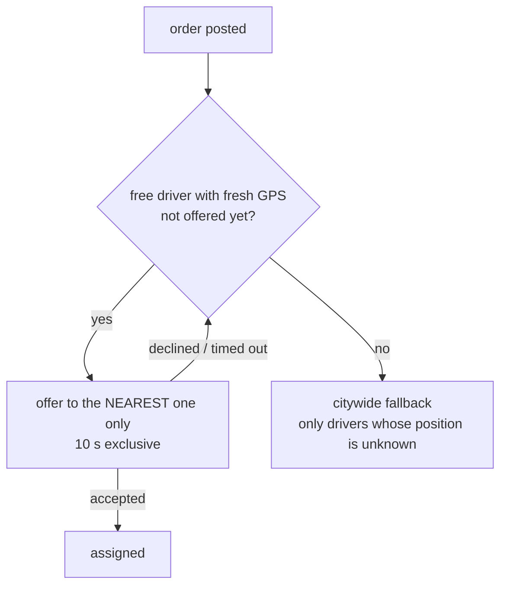

# Dispatch design

Dispatch decides **who hears an order, when, and when they may accept it**. The rules came from the business (fairness to drivers, priority partners, customers wanting the nearest car) and are enforced by the server. Offers are rows in `DispatchOffer`; a push notification only *announces* an offer and never grants one.

## Order types

| Order | Who posts it | How it is dispatched |
|---|---|---|
| Global | driver / staff | broadcast in two waves |
| Distance | driver / staff | rings 1 → 2 → 3 → 4 km around a point, then citywide; each ring at once |
| Customer, pickup + destination | customer app | fixed price; **one driver at a time, nearest first** |
| Customer, pickup only (+ voice/text note) | customer app | staff only, until a staff member accepts or edits and releases it as a distance order from the pickup |

## Global orders: two waves and a fair accept lock

```mermaid
gantt
  dateFormat  s
  axisFormat  %S s
  section VIP drivers
  hear order                 :0, 1
  may accept at once         :0, 9
  section Free drivers
  hear order                 :0, 1
  voice note (5 s)           :0, 5
  accept locked (+3 s)       :5, 8
  section Drivers on a trip
  wave 2 (5 s later)         :5, 6
```



- **Wave 1** (immediately): VIP drivers and drivers without an active trip.
- **Wave 2** (+5 s): everyone else.
- **Accept lock**:
  - VIP drivers: 0 s.
  - Everyone else: *voice-note length + 3 s* (3 s without a note).
  - The server stores `acceptNotBefore` on each offer and refuses earlier accepts. The app shows the same countdown on every surface (popup, in-app card, active-orders list), and it starts when the voice note actually *finishes playing* on that phone.
- **Winner reveal**: when a VIP accepts immediately, the other drivers still see the order until their own lock ends. Only then is it shown as taken. Nobody learns the outcome before they could have competed.

## Distance orders (driver / staff)



- Every driver in a ring is offered the order at the same moment. There is no VIP preference in rings.
- The band time is a staff setting (1–30 s, default 15 s).
- Only drivers with a GPS fix less than 2 minutes old are ranked. Busy, banned and excluded drivers and the poster are skipped.
- Each step is a durable continuation. The next ring is triggered by the order's own update event, so a worker restart does not strand a search.

## Customer orders: the nearest driver, alone



- Rings with nobody in them are skipped instantly: if 1 km and 2 km are empty, the nearest driver at 2.7 km is offered at once.
- Past 4 km it **still** goes one driver at a time, nearest first. Earlier it switched to a broadcast after 4 km, which broke the customer promise; this was fixed and covered by a test.
- Customer orders that carry only a pickup and a voice or text note are invisible to drivers. The filter applies to the document API, the realtime stream and push alike. Staff accept the order, or edit everything except the customer's name and phone and release it as a distance order around the pickup.

## Fixed customer prices

```
road distance  = fastest driving route between pickup and destination (OpenRouteService)
base fare      = start fare + rate per km × (road km + 0.5 km if < 5 km, else + 1 km), rounded to 100 Ks
customer pays  = base fare + admin fee + demands added during the trip
```

- Prices come from server settings, with time-of-day slots (higher start fares at night).
- A quote is **signed** (HMAC) and expires after 2 minutes. When the order is created, the server re-checks the signature, the customer and session, the pickup and destination, and the current pricing fingerprint, so a client cannot alter a price.
- Demands are standard extra charges. They can be added or removed during the trip, the customer sees the new total live with a chat notice, and settlement verifies that *fixed price + demand lines + fee* matches.

## Live tracking for the customer

- During a customer ride, the driver phone sends a fix every 3–5 s with its **age**, measured on the phone's monotonic clock, rather than its time. The server dates it with its own clock.
- The customer app reads the driver position, ride stage (approaching / arrived / departed) and an ETA road route through one authorised call. Each response is checked against the assigned driver.

## Verifying it

- **45 automated backend tests** run against a real PostgreSQL. They cover rings, sequential customer dispatch (including the skip-empty and beyond-4-km cases), staff-only visibility, demand settlement and more.
- **Live drills on production** (`mock-dispatch`):
  - 10 synthetic drivers, with VIP, free and busy mixes;
  - two posters at the same moment, with voice notes;
  - real users' push tokens set aside during the run and restored afterwards.
  - The drill checks who received each order and when, the lock per driver, the wave-2 timing and cancellation.
  - It runs *right after a worker restart* as well as warm, because cold start is where one bug hid.
