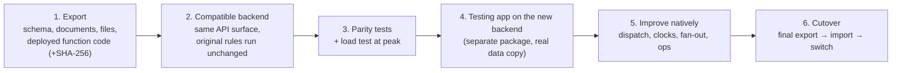

# Migration: from a managed BaaS to an owned backend

## Why move

The app started on a managed Backend-as-a-Service: hosted database, serverless functions, realtime and storage. As traffic grew, four problems appeared:

- **Latency.** Each business action was a cold-startable function plus several database round trips across the network. Dispatch to ~1,000 drivers took seconds.
- **Cost.** Usage was billed per execution and per read, and dispatch fan-out multiplies reads.
- **Control.** There was no access to the database planner, indexes, transactions across collections or long-running workers.
- **Limits.** Transaction size limits, function time limits and counts capped at 5,000 documents.

## Constraints

1. **About 1,000 users must not notice.** The installed Android app cannot be force-updated overnight.
2. **The business rules are the asset.** About 10,000 lines of server-side rules (dispatch, settlement, wallet, sessions) had been refined over months. Rewriting them would risk regressions in money and dispatch.
3. One person operates it.

## Strategy: compatibility first, then improvement

**1. Read-only export.**
- Scripts pulled every collection's schema and documents (paging past the 5,000 count cap), every stored file, and the code **actually deployed** for every server function. The repository copy can drift from what runs in production, so the deployed code was the source of truth.
- Each function bundle was hashed (SHA-256) so any later change to it is visible.

**2. A compatible backend.**
- The new API answers the same document queries, realtime channels, storage URLs and function-execution calls as the old platform. The existing app only needs a new endpoint.
- The original business functions run **unchanged** inside the new server through a thin SDK adapter that maps their database calls to PostgreSQL transactions.
- Every later edit to those files is a marked, documented block, and the hash list is updated with it.

**3. Data import and reconciliation.**
- Each collection becomes a typed PostgreSQL table, with indexes recreated from the exported definitions.
- Counts and samples are compared against the export.
- File references inside documents are rewritten to the new storage.

**4. Side-by-side testing.**
- A separate **Testing** build (own package name, icon and Firebase project) installs next to the store app and talks to the new backend.
- Real-world flows were exercised by the team on phones.

**5. Native improvements**, once parity held:
- bulk offer fan-out;
- server-clock time handling;
- `NOTIFY`-driven worker;
- sequential customer dispatch;
- an admin console;
- per-event observability.

**6. Cutover.** The switch is scripted:
1. final export;
2. import;
3. file sync;
4. smoke test;
5. point the store app at the new endpoint.

Afterwards, stricter rules turn on, for example requiring a session for settlement once every phone has the new app.

## What made it work

- **Don't rewrite the rules; move them.** Running the original code first made correctness a question of *infrastructure* parity, which can be tested, rather than *rule* parity, which is hard to test.
- **Evidence before change.** Every fix in the incident log started with a diagnostic script run on the real server.
- **Reversible steps.** Each upgrade keeps the previous release. Destructive clean-ups run only after a fresh off-site backup.
