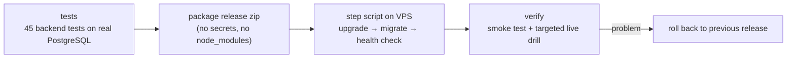

# Operations and quality

## Release flow

- Every backend change ships as a versioned release with a numbered step script that says in plain words what it changes. Each step's output is reviewed before the next one runs.
- `upgrade`:
  - unpacks the release next to the running one and keeps `.env` and secrets;
  - builds the images, applies migrations and restarts;
  - waits for health checks;
  - keeps the last two releases for rollback.
- **Android**: a build script applies the reviewed commits to a clean copy of the project. It then builds the optimized Testing app, runs lint and unit tests, and proves the APK contains the newest change before anyone installs it.

## Testing strategy

| Level | What | Why |
|---|---|---|
| Unit / integration | `node:test` against a real PostgreSQL: policies, console, sessions, settlement, dispatch rings, sequential customer dispatch, fare and clock normalisation | Business rules and SQL semantics are tested together; mocks would hide transaction behaviour |
| Load | Synthetic drivers and customers from a separate machine at the agreed peak (200 concurrently active drivers), measuring p50/p95 per operation | Validates the 200 ms p95 budget on the real 4 vCPU / 8 GB host, including CPU steal checks |
| Live drills | `mock-dispatch` on production: 10 synthetic drivers (VIP / free / busy), voice notes, simultaneous posters, cold and warm worker | The only way to test push, timing and the worker together. Real users' push tokens are set aside during the drill |
| Diagnostics | Read-only scripts: the customer's view of a ride, the database during a drill, per-operation call rates | Every incident fix starts from evidence |

## Observability

- **Per order event**: queue delay, run time, offers created, pushes sent and failed.
- **Push failures** grouped by FCM error code (e.g. a token from another Firebase project, an uninstalled app).
- **Live driver positions** for customer rides: one line per ride per minute, accepted or the refusal reason.
- **Per-action metrics**: call counts and p50/p95, plus `pg_stat_statements` for the most expensive SQL.
- **Traffic audit** (10-minute sample of real use) to find chatty clients. It cut chat polling from 27 to 7 calls per minute per phone.

## Monitoring and backups

| Job | Schedule | Detail |
|---|---|---|
| Health monitor | every 5 min | site up; containers healthy and not restarted or OOM-killed; disk < 85 %; memory ≥ 400 MB free; last backup < 26 h old; p95 under 200 ms. Telegram alert on problem **and** recovery |
| Backup | daily, 03:00 Myanmar time | database dump + uploaded files to off-site storage, upload size verified, 30 days of dumps kept off-site and 7 days on the server |
| Maintenance | hourly | expired sessions, old order-id reservations, resolved dispatch rows |

## Cost and capacity

- One 4 vCPU / 8 GB VPS runs everything. Postgres is capped at 4 GB and the app containers have their own memory limits.
- The busiest write path (driver positions, every few seconds per online driver) uses an UNLOGGED table and coalesced realtime fan-out.
- Capacity headroom is checked with the same load harness before each larger change.
